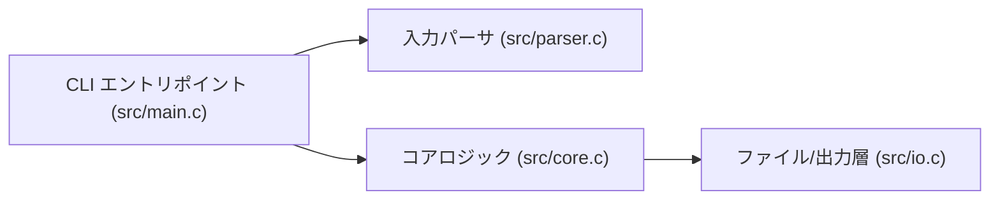

# 基本設計書テンプレート（C11 プロジェクト）

## 1. アーキテクチャ設計

### 1-1. システム全体構成
[アプリケーションの実行形態（CLI / 静的ライブラリ等）と処理の全体像を簡潔に記述する。]

### 1-2. モジュール構成と責務

| モジュール名 | 公開ヘッダ | 実装ファイル | 責務 | 主な依存 |
| --- | --- | --- | --- | --- |
| core | `include/core.h` | `src/core.c` | 中核となる計算・ビジネスロジック | C11標準ライブラリ |
| parser | `include/parser.h` | `src/parser.c` | 引数・入力テキストの解析と検証 | `core` |
| cli | — | `src/main.c` | コマンド引数解釈・終了コード制御 | `parser`, `core` |

### 1-3. 要件とモジュールの対応（トレーサビリティ）

| 要件ID | 機能名 | 担当モジュール | 備考 |
| --- | --- | --- | --- |
| REQ-01 | [機能名] | `parser`, `core` | |
| REQ-02 | [機能名] | `core`, `cli` | |

### 1-4. 技術スタック

| 区分 | 採用技術 | 備考 |
| --- | --- | --- |
| 開発言語 | C11 (`CMAKE_C_EXTENSIONS OFF`) | 厳格な標準準拠 |
| ビルドシステム | CMake 3.16+ | ビルド出力は `build/` 限定 |
| コンパイラ警告 | `-Wall -Wextra -Werror` / `/W4 /WX` | 警告ゼロ必須 |
| 単体・結合・CLIテスト（実行手段） | `ctest` (CMake CTest) | `--timeout 10` 付きで実行 |
| 動的検査 | ASan / UBSan (`-DENABLE_SANITIZERS=ON`) | 対応環境で Debug ビルドに適用 |
| 整形 / 静的解析 | `clang-format` / `cppcheck` | PostToolUse フックで自動実行 |

---

## 2. インターフェース設計

### 2-1. CLI 仕様（CLI を提供する場合）
- **書式**: `<app_name> [options] <input>`
- **オプション一覧**:

| オプション | 引数 | 説明 | デフォルト |
| --- | --- | --- | --- |
| `-h`, `--help` | なし | ヘルプを表示して終了コード 0 で終了 | — |
| `-o`, `--output` | `<path>` | 出力ファイルパスを指定 | 標準出力 |

- **終了コード**:
  - `0`: 正常終了
  - `1`: 実行時エラー（I/O失敗・処理エラー）
  - `2`: 引数・入力フォーマット不正

### 2-2. 公開 C API 概要

| 関数名 | 公開ヘッダ | 概要 | 戻り値 |
| --- | --- | --- | --- |
| `core_process(...)` | `include/core.h` | 入力バッファを処理して結果を返す | `core_status_t` |

---

## 3. データ・ファイル形式設計

### 3-1. 入出力フォーマット
- **文字コード**: UTF-8
- **改行コード**: LF / CRLF 両対応で読み込み、出力は LF（または要件準拠）
- **最大サイズ制約**: [例: 1行最大 4096 バイト、超過時はエラー返却]

---

## 4. 非機能・安全性設計

- **メモリ管理方針**: 動的メモリ確保は必要最小限とし、確保者と解放者の所有権を詳細設計で明示する。
- **境界・数値安全**: バッファは常に `size_t` 容量と対で受け渡し、`snprintf` 等の境界付き関数のみ使用する。
- **エラー伝播**: ライブラリ関数は `exit()` / `abort()` を呼ばず、エラーコードまたは `bool` で呼び出し元へ返す。
- **移植性**: OS 固有 API に依存する処理がある場合は専用モジュールへ隔離する。
