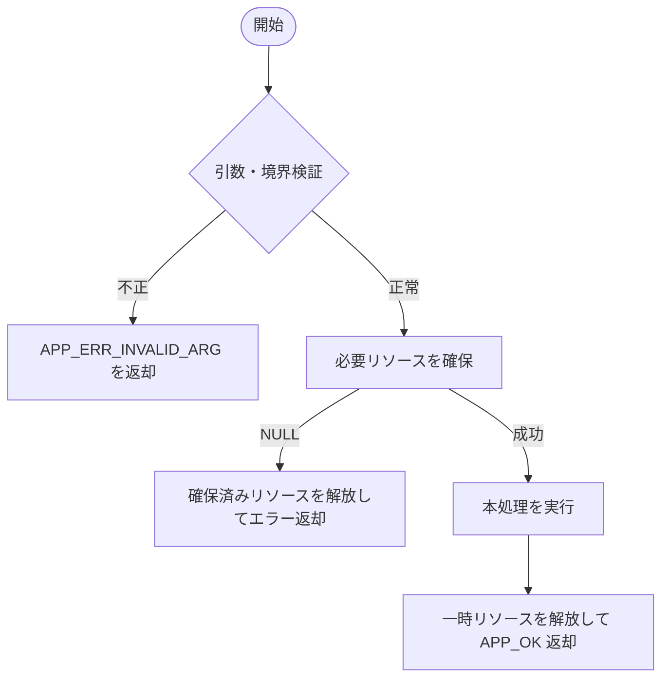

# 詳細設計書テンプレート（C11 プロジェクト）

## 1. ファイル・ターゲット構成

```text
project-root/
├── CMakeLists.txt
├── include/
│   └── <module>.h          # 公開API・型定義（インクルードガード必須）
├── src/
│   └── <module>.c          # モジュール実装（内部関数は static）
└── tests/
    └── test_<module>.c     # CTest 登録する単体・結合テスト
```

### CMake ターゲット構成

| ターゲット名 | 種別 | ソースファイル | 依存ターゲット | 役割 |
| --- | --- | --- | --- | --- |
| `app_core` | `STATIC` ライブラリ | `src/<module>.c` | `project_options` | コアロジック |
| `test_<module>` | テスト実行ファイル | `tests/test_<module>.c` | `app_core`, `project_options` | CTest テスト |

---

## 2. データ構造・型定義

### 2-1. ステータスコード (`enum`)

```c
typedef enum {
    APP_OK = 0,
    APP_ERR_INVALID_ARG = 1,
    APP_ERR_OVERFLOW = 2,
    APP_ERR_OUT_OF_MEMORY = 3,
    APP_ERR_IO = 4
} app_status_t;
```

### 2-2. 主要構造体 (`struct`)

| 構造体名 | 定義場所 | メンバ・型 | 不変条件・所有権 |
| --- | --- | --- | --- |
| `app_buffer_t` | `include/<module>.h` | `uint8_t *data; size_t len; size_t cap;` | `len <= cap`。`data` は `app_buffer_destroy` で解放する |

---

## 3. 公開関数・モジュール設計

### モジュール: `<module>` (`include/<module>.h`)

#### `app_status_t module_do_something(const uint8_t *input, size_t input_len, uint8_t *out, size_t out_cap, size_t *out_len)`
- **責務**: [1行で説明]
- **事前条件**: `out != NULL`, `out_len != NULL`, `input_len == 0 || input != NULL`
- **事後条件**:
  - `APP_OK` 返却時: `*out_len <= out_cap` が成立し、`out[0..*out_len-1]` に結果が格納される
  - エラー返却時: 確保した一時メモリはすべて解放され、出力ポインタを不整合状態にしない
- **メモリ所有権**: 呼び出し側が `input` / `out` のバッファを所有し、関数内で所有権を奪わない
- **エラー条件**:
  - 必須ポインタが `NULL` → `APP_ERR_INVALID_ARG`
  - 出力容量不足 / 算術オーバーフロー → `APP_ERR_OVERFLOW`

---

## 4. 処理シーケンス・制御フロー



---

## 5. エラー処理・境界条件・実装方針

- **単一出口パターン**: 複数リソースを確保する関数では `goto cleanup;` により全経路で解放漏れを防ぐ。
- **境界条件一覧**:

| 項目 | 最小値 | 最大値 | 範囲外時の挙動 |
| --- | --- | --- | --- |
| 入力長 (`input_len`) | `0` | `[上限値]` | 上限超過時は `APP_ERR_INVALID_ARG` |
| 数値演算 | `INT32_MIN` | `INT32_MAX` | 事前検証で `APP_ERR_OVERFLOW`（UB回避） |

- **診断出力**: ライブラリ層（`src/`）は原則 `stdout` に出力せず、エラーコードで呼び出し側へ通知する。CLI 層のみ `stderr` へメッセージを出す。

---

## 6. テスト方針の概要
- **単体テスト**: 各公開関数の正常系・境界値・`NULL` 引数・オーバーフロー・異常系を `tests/test_<module>.c` で網羅し、`ctest --timeout 10` で実行する。
- **メモリ・UB検証**: Sanitizer 対応環境では `-DENABLE_SANITIZERS=ON` の Debug ビルドで全テストを通過させる。
